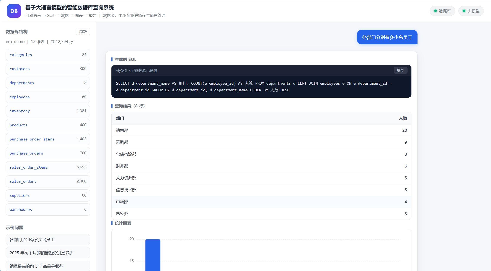
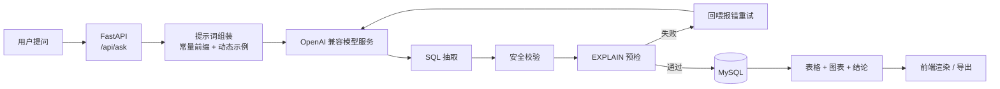
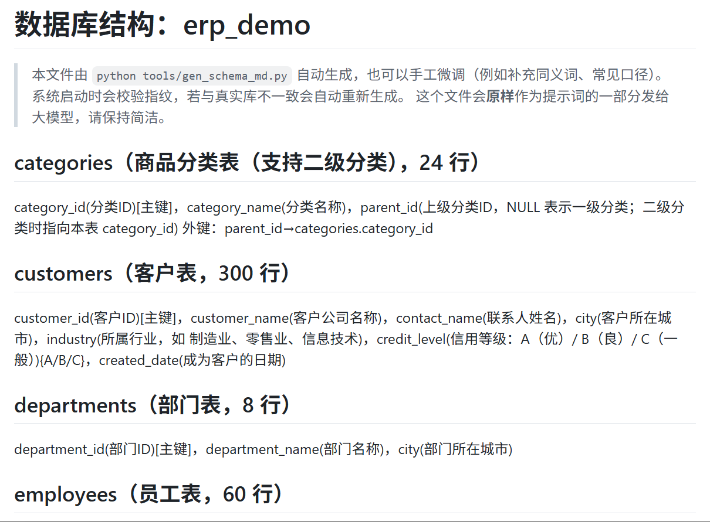
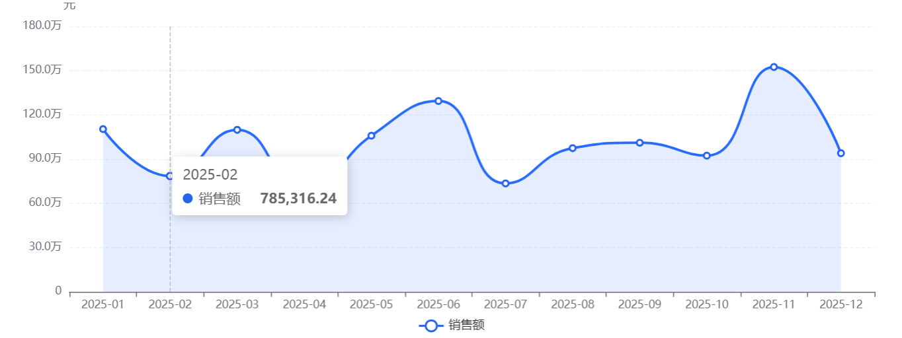
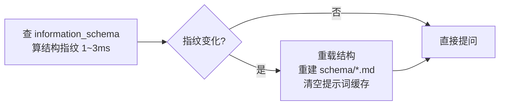

# sql-query-llm

**用自然语言查询数据库。** 输入一句中文问题，系统自动理解意图、生成 SQL、执行、出表格、出图表、
生成结论，并支持一键导出 Word / PDF。

- 数据源：MySQL 8（内置一套可一键复现的 ERP 示例库：12 张表 / 12,394 行）
- 大模型：任意 OpenAI 兼容服务（llama.cpp / Ollama / LM Studio / vLLM / 云端 API）
- 后端：FastAPI + PyMySQL　｜　前端：原生 HTML/CSS/JS + 本地 ECharts（不依赖外网 CDN）

实测（RTX 4060 Laptop 8GB + Qwen2.5-Coder-7B Q4_K_M）：

| 指标 | 结果 |
|---|---|
| 执行准确率（结果集完全一致） | **28/30 = 93.3%** |
| 执行准确率（允许列多选/数值舍入） | **30/30 = 100%** |
| 提问 → SQL + 表格 + 图表就绪 | 平均 **1.53s**，96.7% 在 3s 内 |
| 完整链路（含 AI 文字结论） | 平均 2.54s |



---

## 为什么做这个

把 `text2sql` 跑通只占工作量的一小部分。真正影响体验的是三件事：

1. **慢**。7B 模型在消费级显卡上解码约 35 tokens/s，3 秒预算只够生成 ~105 个 token。
   所以这不是"换个更大的模型"能解决的问题，而是要**让模型少说话**。
2. **错**。模型会漏 `WHERE` 条件、混用 `status` 和 `category`、多选一列主键导致结果集对不上。
   需要把业务口径、字段语义、枚举取值全部写进提示词，并在执行前做校验。
3. **变**。数据库结构会改。加一张表就要重启、改代码，系统就失去了实用性。

这个项目针对这三点做了工程化处理，并在 [docs/evaluation-report.md](docs/evaluation-report.md)
里给出了可复现的量化结果。

---

## 核心特性

| 特性 | 说明 |
|---|---|
| **3 秒内出结果** | 结构文档固化成常量前缀命中 KV 缓存；动态示例后置；答案解析复用同一轮上下文；图表类型用规则判定而非再调一次模型 |
| **只读安全** | 白名单（仅 `SELECT`/`WITH`）+ 危险关键字黑名单 + 单语句校验 + `EXPLAIN` 预检 + 执行超时 + 结果裁剪 |
| **失败自动重试** | 把 MySQL 的原始报错回喂模型纠正，最多 2 次，全过程记录在响应的 `steps` 里 |
| **图表自动选择** | 纯规则判定折线/柱状/饼图/柱线组合，零额外模型开销，比让模型选更稳定 |
| **结构变更自动感知** | 每次提问前用 `information_schema` 算结构指纹（1~3ms，带节流），变了就重建结构文档并清缓存，**无需重启** |
| **本地离线可跑** | 模型、数据库、前端依赖全部本地，不出网 |

---

## 架构



一次提问的耗时会被拆成多段返回并展示，便于验证性能：

```
SQL 生成 1.36s ｜ 数据库执行 0.01s ｜ 结论生成 0.98s ｜ 结果就绪 1.53s ｜ 完整 2.54s
```

---

## 快速开始

### 0. 前置条件

- Python 3.10+
- MySQL 8.0+（本地或 Docker 均可）
- 一个 OpenAI 兼容的模型服务

### 1. 准备模型服务

```powershell
# 方案一：llama.cpp（本项目实测，延迟最低）
#   下载引擎与模型 → 见 deploy/README.md
powershell -ExecutionPolicy Bypass -File .\deploy\scripts\start_llama_server.ps1

# 方案二：Ollama（最省事）
ollama pull qwen2.5-coder:7b && ollama serve
```

`deploy/README.md` 里有四条路线的完整步骤（llama.cpp / Ollama / LM Studio / vLLM）、
显存预算表和模型选型建议。

### 2. 安装依赖

```powershell
python -m venv .venv
.\.venv\Scripts\Activate.ps1
pip install -r requirements.txt
```

### 3. 配置

```powershell
Copy-Item .env.example .env
# 按需修改数据库口令与模型地址
```

### 4. 建库并启动

```powershell
python tools/build_erp_db.py --rebuild   # 建库、建表、灌数据（固定随机种子，结果可复现）
python run.py                            # http://127.0.0.1:8000
```

打开 <http://127.0.0.1:8000> 即可提问。服务启动时会在后台预热提示词缓存，
因此第一个问题也不是冷启动。

---

## 配置项

全部通过环境变量或 `.env` 覆盖，代码中不含绝对路径与硬编码口令。

| 变量 | 默认值 | 说明 |
|---|---|---|
| `DB_HOST` / `DB_PORT` | `127.0.0.1` / `3306` | MySQL 地址 |
| `DB_USER` / `DB_PASSWORD` | `root` / `123456` | 数据库账号 |
| `DB_NAME` | `erp_demo` | 数据库名 |
| `LLM_BASE_URL` | `http://127.0.0.1:8080/v1` | OpenAI 兼容接口地址 |
| `LLM_MODEL` | `qwen2.5-coder-7b-instruct` | 模型名 / 别名 |
| `LLM_API_KEY` | `not-needed` | 本地服务可留默认 |
| `QUERY_TIMEOUT` | `10` | 单条 SQL 执行超时（秒） |
| `MAX_RETRY` | `2` | 生成失败后的重试次数 |
| `MAX_RESULT_ROWS` | `2000` | 返回前端的最大行数 |
| `WEB_HOST` / `WEB_PORT` | `127.0.0.1` / `8000` | Web 服务监听地址 |

---

## 项目结构

```
.
├─ app/                     # 后端
│   ├─ main.py              # FastAPI 路由
│   ├─ service.py           # 业务编排：SQL → 执行 → 结论 → 图表，并统计各阶段耗时
│   ├─ text2sql.py          # Text-to-SQL 核心：提示词组装 + 校验 + 重试
│   ├─ sqlguard.py          # SQL 安全防护（只读白名单 + 危险关键字黑名单）
│   ├─ schema.py            # 结构读取、结构文档生成、变更指纹检测
│   ├─ executor.py          # SQL 执行（超时保护 + 结果裁剪）
│   ├─ answer.py            # 结果 → 自然语言结论（含后端预计算统计量）
│   ├─ chart.py             # 图表类型推荐（纯规则）
│   ├─ export.py            # Word 报告生成
│   └─ llm.py               # OpenAI 兼容客户端
├─ web/                     # 前端（原生 JS + 本地 ECharts）
├─ sql/                     # 建库脚本与示例数据
├─ schema/erp_demo.md       # 结构文档：作为提示词的一部分原样发送
├─ eval/                    # 执行准确率评测（30 题 + 参考答案 SQL）
├─ tools/                   # 命令行工具（建库、自检、基准、调试）
├─ deploy/                  # 模型服务部署指南与脚本
├─ docs/                    # 截图、提示词快照、评测报告
└─ config.py                # 配置（环境变量优先）
```

---

## 工作原理

### 1. 提示词：常量前缀 + 业务口径 + 动态示例

提示词唯一来源是 `app/text2sql.py` 的 `SYSTEM_HEAD`，结构固定为：

```
[角色] + [9 条业务口径] + [全库结构文档] + [10 条输出要求] + [按问题挑选的 3 条示例]
└────────────────── 常量前缀（命中 KV 缓存） ──────────────────┘ └─ 动态部分 ─┘
```

前三段内容恒定，llama.cpp 按最长公共前缀复用 KV 缓存，**前处理耗时趋近于 0**；
只有最后的示例部分每次重新计算。这是把响应压到 3 秒内的关键。

结构文档被压缩成"一行一张表"的紧凑格式，从约 2100 tokens 降到约 840 tokens：



想查看模型实际收到的完整提示词：

```powershell
python tools/dump_prompt.py "2025 年每个月的销售额分别是多少"
```

会在 `docs/prompt-example.md` 生成快照（约 5,500 字符 / 1,560 tokens）。
快照仅用于查看与留档，程序运行时不读取它。

### 2. 生成后必过的四道关

```
模型输出 → 抽取 SQL → 只读安全校验 → EXPLAIN 预检 → 执行（超时 10s，最多 2000 行）
                ↑                          ↓
                └────── 失败回喂报错重试（≤2 次） ─────┘
```

- **抽取**：优先取 Markdown 围栏内容，否则从第一个 `SELECT`/`WITH` 截断
- **安全**：必须以 `SELECT`/`WITH` 开头、不允许分号（防多语句）、黑名单拦截 DDL/DML/文件读写/睡眠函数
- **预检**：`EXPLAIN` 能在不扫数据的前提下暴露表名/字段名幻觉、语法错误、JOIN 条件缺失
- **执行**：`SET SESSION max_execution_time` 防全表扫描拖垮服务

### 3. 图表：规则判定，不额外调模型

| 优先级 | 条件 | 图表 |
|---|---|---|
| 1 | 维度值 ≥80% 匹配时间格式 | 折线图 |
| 2 | 单度量 + 行数 ≤8 + 问题含"占比/构成/分布..." | 饼图 |
| 3 | 度量 ≥2 个 | 柱线组合 |
| 4 | 其他 | 柱状图 |

前置条件：列数 ≥2、行数 2~60、至少一列全为数值。

| 时间维度 → 折线 | 占比关系 → 饼图 |
|---|---|
|  |  |

### 4. 结构变更自动感知



新表的枚举列按"列类型 ENUM / 列名模式"自动识别并采样真实取值，**无需改代码**。
代价是变更后的第一次提问因缓存失效会多约 2 秒，之后恢复正常。

---

## 评测

评测集 `eval/questions.json` 共 30 题，覆盖 15 类场景（单表聚合、多表 JOIN、自连接、子查询、
时间趋势、Top-N、条件过滤、库存预警等），每题带一条人工编写的参考答案 SQL。

**判定方式不是比对 SQL 文本，而是比对结果集**——同一业务问题有几十种正确写法，
文本比对没有意义。两边的 SQL 都在真实 MySQL 上执行后比较结果：

- 归一化：`Decimal→float`、浮点保留 2 位、日期转 ISO、字符串去空白、行序无关（排序后比多重集）
- **严格**：归一化后行多重集完全相同
- **宽松**：列数相同时允许数值容差（绝对 ≤0.05 或相对 ≤0.5%）；
  列数不同时允许"列子集匹配"（覆盖"多带一列主键"的情况）

```powershell
python eval/run_eval.py                # 全量
python eval/run_eval.py --ids 9,12,20  # 指定题号
```

结果：**严格 28/30 = 93.3%，宽松 30/30 = 100%，结果就绪平均 1.53s，0 次重试**。
两道严格未通过的题都是"多选了一列编码"，值集完全正确。

完整明细见 [docs/evaluation-report.md](docs/evaluation-report.md)。

---

## 常用命令

```powershell
python run.py                          # 启动 Web 服务
python tools/build_erp_db.py --rebuild # 重建数据库与示例数据
python tools/verify_db.py              # 数据质量自检（外键完整性、异常值、分布）
python tools/gen_schema_md.py          # 手动刷新结构文档
python tools/ask.py "各部门有多少人"     # 命令行提问，便于排查
python tools/bench_ask.py              # 端到端耗时基准
python deploy/scripts/check_llm.py     # 模型服务自检（连通性 / 吞吐 / SQL 粗测）
python tools/test_export.py            # Word 导出接口验收
python tools/test_schema_change.py     # 结构变更自动感知验收（10 项检查）
python tools/build_er_diagram.py       # 从真实结构重新生成 ER 图（需 Graphviz）
```

---

## 常见问题

**Q：界面提示"无法连接大模型服务"？**
模型服务没起来。按 `deploy/README.md` 启动；用 `curl http://127.0.0.1:8080/v1/models` 确认。

**Q：数据库连接失败？**
检查 MySQL 是否运行、`.env` 里的 `DB_*` 是否正确。

**Q：第一个问题比后面的慢？**
服务启动时会后台预热缓存。若在预热完成前提问，会退化为冷启动（多约 2 秒）。

**Q：某道题答错了怎么调？**
用 `python tools/ask.py "问题"` 看生成的 SQL。改进优先级：
补充业务口径 → 在 `app/fewshot.py` 增加针对性示例与关键词 → 调整 `schema/erp_demo.md` 的字段注释。

**Q：能接云端大模型吗？**
可以，任何 OpenAI 兼容接口都行，改 `LLM_BASE_URL` / `LLM_MODEL` / `LLM_API_KEY` 即可。
注意数据合规。

---

## 已知限制

1. **准确率与耗时受硬件制约**。7B 模型在 RTX 4060 Laptop 上约 35 tokens/s；
   换 14B/32B 会更准但需要更大显存，换更小的模型则相反。
2. **超长 SQL 会超过 3 秒**。涉及 5 张表以上 JOIN 的复杂问题，SQL 本身约 90+ tokens，耗时约 4 秒。
3. **不支持多轮上下文追问**。"再按月份拆分一下"这类指代当前提问是独立会话。
4. **复杂嵌套子查询 / 窗口函数**覆盖有限，评测集未覆盖。
5. **PDF 导出**采用浏览器打印，未做服务端渲染。

## Roadmap

- [ ] 多轮对话（追问与结果复用）
- [ ] 多数据源适配（PostgreSQL / SQLite）
- [ ] 语义层（指标与维度建模），降低对提示词长度的依赖
- [ ] 服务端 PDF 渲染

---

## 许可证

[MIT](LICENSE)
